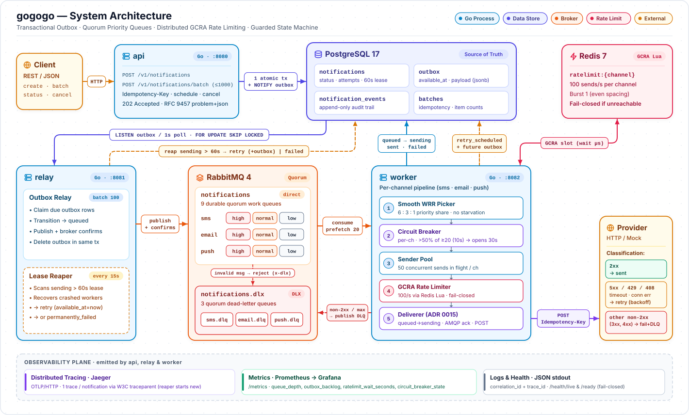
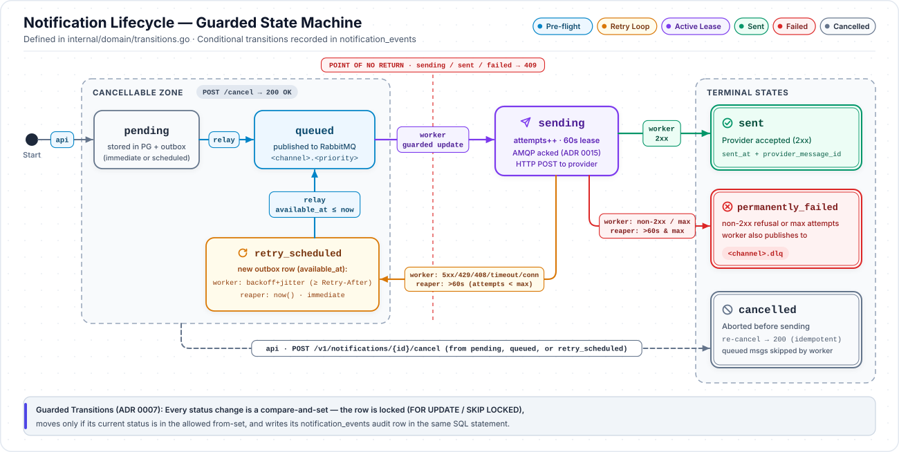

<div align="center">

# 📬 gogogo

**An event-driven notification service written in Go.**

Accepts notification requests over HTTP and delivers them asynchronously over **SMS**, **Email** and
**Push**, with per-channel rate limiting, priorities, retries and status tracking.

[](https://github.com/muzaffercanan/gogogo/actions/workflows/ci.yml)


[Quick start](#-quick-start) ·
[Architecture](#-architecture) ·
[API](#-api) ·
[Observability](#-observability) ·
[Load test](#-load-test) ·
[Decisions](#-design-decisions)

</div>

---

## ✨ Highlights

| | Feature | How |
|---|---|---|
| 🛡️ | **Durable ingest** | Accepting a notification is one PostgreSQL transaction (notification + outbox row), so the API keeps accepting while RabbitMQ, Redis or the provider are down. |
| 🚦 | **Rate limit** | At most **100 sends per second per channel** across all workers, evenly spaced (GCRA in Redis). |
| ⚖️ | **Priorities** | Three queues per channel (high, normal, low) served **6:3:1** by weighted round-robin, so a busy high priority cannot starve the others. |
| 🔁 | **Retries** | Server errors, 429 and timeouts are retried with exponential backoff and full jitter (honouring `Retry-After`). Refusals and exhausted retries are dead-lettered. A circuit breaker per channel pauses sending while the provider is failing. |
| 🎯 | **At-least-once delivery** | Guarded state transitions make sure exactly one actor wins every race (cancel against send, duplicate messages, crashed workers). Every provider call carries `Idempotency-Key: <notification id>`. |
| 🧩 | **API** | Single and batch creates (up to 1000) with idempotency keys, scheduling up to 30 days ahead, cancellation, filtered and cursor-paginated listing, batch status. RFC 7807 errors throughout. |
| 🔭 | **Observability** | Prometheus metrics with a provisioned Grafana dashboard, OpenTelemetry traces in Jaeger (one trace per notification, across retries), JSON logs with a correlation ID. |

<table>
  <tr>
    <td align="center"><b>~10 000/s</b><br><sub>notifications accepted into PostgreSQL</sub></td>
    <td align="center"><b>100/s</b><br><sub>sends per channel, held across workers</sub></td>
    <td align="center"><b>6 : 3 : 1</b><br><sub>high : normal : low share</sub></td>
    <td align="center"><b>1000</b><br><sub>notifications per batch</sub></td>
  </tr>
</table>

## 📑 Contents

- [Quick start](#-quick-start)
- [Architecture](#-architecture)
- [API](#-api)
- [Configuration](#-configuration)
- [Observability](#-observability)
- [Testing](#-testing)
- [Load test](#-load-test)
- [Project layout](#-project-layout)
- [Design decisions](#-design-decisions)
- [Not included](#-not-included)

## 🚀 Quick start

> [!NOTE]
> Needs Docker with Compose. Go 1.27 is only needed to build or test outside containers.

```sh
cp .env.example .env        # optional: defaults work as they are
docker compose up --build -d
curl -s localhost:8080/health/ready
```

This starts PostgreSQL, RabbitMQ, Redis, the migrations, the api, relay and worker processes, a mock
provider, Jaeger, Prometheus and Grafana.

| What | Where |
|---|---|
| 🧩 API, with Swagger UI at `/docs` | <http://localhost:8080> ([OpenAPI spec](api/openapi.yaml)) |
| 📊 Grafana, `Notifications` dashboard | <http://localhost:3000> (no login, bound to localhost) |
| 🔍 Jaeger | <http://localhost:16686> |
| 📈 Prometheus | <http://localhost:9091> |
| 🐇 RabbitMQ management | <http://localhost:15672> (guest / guest) |
| ⚙️ Ops ports of relay and worker (`/health/*`, `/metrics`) | 8081, 8082 |
| 🤖 Mock provider | <http://localhost:9090> |

Workers deliver to the bundled mock provider, which answers after 50 ± 50 ms and can be told to fail
(`MOCK_*` in [`.env.example`](.env.example)).

> [!TIP]
> To deliver to [webhook.site](https://webhook.site) instead, set `PROVIDER_URL` in `.env` to your own
> URL there and run `docker compose up -d worker`.

`make down` stops the stack; `docker compose down -v` also deletes the database.

## 🧱 Architecture

<picture>
  <source media="(prefers-color-scheme: dark)" srcset="docs/diagrams/architecture-dark.svg">
  <source media="(prefers-color-scheme: light)" srcset="docs/diagrams/architecture-light.svg">
  
</picture>

| Process | Role |
|---|---|
| **api** | Validates a request and writes the notification and an outbox row in one transaction, then answers `202 Accepted`. PostgreSQL is its only dependency. |
| **relay** | Claims due outbox rows (`FOR UPDATE SKIP LOCKED`), marks their notifications `queued` and publishes them to `<channel>.<priority>` with publisher confirms before it commits. It wakes on `NOTIFY` and polls every second as a fallback. Its **reaper** gives notifications whose worker died while sending (a 60 s lease) back to the retry path. |
| **worker** | Consumes the three queues of each channel. A weighted round-robin picks the next message, the worker takes a slot from the rate limiter, moves the notification `queued → sending`, acks the message and calls the provider. The outcome is `sent`, `retry_scheduled` (a new outbox row with `available_at` in the future; retries and scheduled sends use the same mechanism) or `permanently_failed` (also published to the channel's dead-letter queue). |

All three processes are built into one image and scale independently.

### Notification lifecycle

<picture>
  <source media="(prefers-color-scheme: dark)" srcset="docs/diagrams/lifecycle-dark.svg">
  <source media="(prefers-color-scheme: light)" srcset="docs/diagrams/lifecycle-light.svg">
  
</picture>

`pending`, `queued` and `retry_scheduled` can be cancelled; `sent`, `permanently_failed` and
`cancelled` are terminal. Every transition is a conditional update recorded in `notification_events`,
defined in [`internal/domain`](internal/domain). The reasons behind each choice are in the
[architecture decision records](docs/adr/README.md).

## 🧩 API

The contract is [`api/openapi.yaml`](api/openapi.yaml); handlers are generated from it. Swagger UI is
served at <http://localhost:8080/docs>.

| Method | Path | Does |
|---|---|---|
| `POST` | `/v1/notifications` | create one (optionally scheduled, with an `Idempotency-Key`) |
| `POST` | `/v1/notifications/batch` | create up to 1000, each item validated on its own |
| `GET` | `/v1/notifications` | list with filters, cursor-paginated |
| `GET` | `/v1/notifications/{id}` | get one with its status and attempts |
| `POST` | `/v1/notifications/{id}/cancel` | cancel one that has not started sending |
| `GET` | `/v1/batches/{id}` | status counts and a page of a batch's notifications |

### Create a notification

`priority` defaults to `normal`. The `Idempotency-Key` header is optional: a retry with the same key
and body returns the original with `Idempotent-Replayed: true`, while the same key with another body
is refused with `422`.

```sh
curl -si localhost:8080/v1/notifications \
  -H 'Content-Type: application/json' -H 'Idempotency-Key: 5d3c1a7e-2b4f-4e8a-9c6d-1f0e2a3b4c5d' \
  -d '{"channel":"sms","recipient":"+905551234567","content":"Your code is 482913","priority":"high"}'
```

```http
HTTP/1.1 202 Accepted
Location: /v1/notifications/01a20f9a-4774-790a-b556-1d5b72dda574
Idempotent-Replayed: false
X-Correlation-Id: 01a20f9a-476a-7d09-8b15-cc1f7ce9ede3

{"id":"01a20f9a-4774-790a-b556-1d5b72dda574","status":"pending","channel":"sms","priority":"high", ...}
```

Get it. Under a second later it has been sent:

```sh
curl -s localhost:8080/v1/notifications/01a20f9a-4774-790a-b556-1d5b72dda574
```

```json
{
  "id": "01a20f9a-4774-790a-b556-1d5b72dda574",
  "status": "sent",
  "attempts": 1,
  "max_attempts": 5,
  "provider_message_id": "c7756c7a-435e-4a02-835b-4163a04d7129",
  "created_at": "2026-11-24T22:08:18.804863Z",
  "sent_at": "2026-11-24T22:08:19.408754Z",
  ...
}
```

<details>
<summary><b>⏰ Schedule and cancel</b></summary>

<br>

Schedule one (`scheduled_at` up to 30 days ahead), then cancel it. Cancelling a notification that is
sending or already sent answers `409`.

```sh
curl -s localhost:8080/v1/notifications -H 'Content-Type: application/json' \
  -d '{"channel":"email","recipient":"jane@example.com","content":"Reminder","scheduled_at":"2026-12-01T09:00:00Z"}'
curl -s -X POST localhost:8080/v1/notifications/<id>/cancel
```

</details>

<details>
<summary><b>📦 Batch create</b></summary>

<br>

Create up to 1000 in one batch. Each item is validated on its own; the batch fails as a whole only if it
is malformed, empty or too large.

```sh
curl -s localhost:8080/v1/notifications/batch -H 'Content-Type: application/json' -d '{"notifications":[
  {"channel":"email","recipient":"jane@example.com","content":"Flash sale starts now!"},
  {"channel":"push","recipient":"not a token","content":"Flash sale starts now!"}]}'
```

```json
{
  "batch_id": "01a20f9a-9fe7-7813-bae5-d9487fba2f38",
  "total": 2, "accepted": 1, "rejected": 1,
  "items": [
    {"index": 0, "result": "accepted", "notification_id": "01a20f9a-9fe7-7b0f-8c30-a35fb7410687"},
    {"index": 1, "result": "rejected",
     "errors": [{"field": "recipient", "code": "invalid_format", "message": "must be a device token without whitespace"}]}
  ]
}
```

</details>

<details>
<summary><b>🔎 Batch status and listing</b></summary>

<br>

Follow a batch (status counts and a page of its notifications) and list notifications with filters
(`status`, `channel`, `created_from`, `created_to`). Pages are cursor-based: pass `next_cursor` back
as `cursor`.

```sh
curl -s localhost:8080/v1/batches/01a20f9a-9fe7-7813-bae5-d9487fba2f38
curl -s 'localhost:8080/v1/notifications?status=sent&channel=sms&limit=20'
```

</details>

<details>
<summary><b>⚠️ Errors</b></summary>

<br>

Errors are `application/problem+json` with one entry per invalid field:

```json
{
  "type": "/problems/validation-error",
  "title": "Validation failed",
  "status": 400,
  "detail": "The request has 2 invalid fields.",
  "instance": "/v1/notifications",
  "errors": [
    {"field": "recipient", "code": "invalid_format", "message": "must be an E.164 phone number, e.g. +905551234567"},
    {"field": "content", "code": "required", "message": "is required"}
  ]
}
```

</details>

### Provider contract

The provider receives `POST {"to", "channel", "content"}` with `Idempotency-Key: <notification id>`
and is expected to answer `202 {"messageId", "status", "timestamp"}`.

| Answer | Outcome |
|---|---|
| 2xx | ✅ accepted |
| 5xx, 429, 408 | 🔁 retried |
| anything else | ❌ failed for good ([ADR 0014](docs/adr/0014-provider-response-classification.md)) |

## 🔧 Configuration

Everything is set through environment variables; [`.env.example`](.env.example) lists them with their
defaults, and Compose reads `.env`. The ones you are most likely to change:

| Variable | Default | Meaning |
|---|---|---|
| `PROVIDER_URL` | the mock provider | where workers deliver |
| `RATE_LIMIT_PER_SECOND` | 100 | sends each channel starts per second, across all workers |
| `MAX_ATTEMPTS` | 5 | attempts before a notification is `permanently_failed` |
| `PRIORITY_WEIGHT_HIGH` / `_NORMAL` / `_LOW` | 6 / 3 / 1 | shares while all priorities have messages waiting |
| `WORKER_CONCURRENCY` | 50 | sends in flight per channel and worker; size it to rate × provider latency |
| `WORKER_PREFETCH` | 20 | unacknowledged messages per work queue and worker |
| `OTEL_EXPORTER_OTLP_ENDPOINT` | Jaeger | set it empty to turn tracing off |

## 🔭 Observability

| | |
|---|---|
| 📈 **Metrics** | Every process serves `/metrics`. Among them: `notifications_sent_total`, `notifications_failed_total`, `retries_total`, `queue_depth`, `outbox_backlog`, `ratelimit_wait_seconds`, `circuit_breaker_state`, `provider_request_duration_seconds` and the HTTP metrics of the API. The `Notifications` dashboard in Grafana shows delivery, queues, health and the API on one page. |
| 🧵 **Traces** | One trace per notification, from the HTTP request through the relay, every attempt and the provider call, including retries and batch items. Open Jaeger and search by service, or by the `notification.id` tag. |
| 📝 **Logs** | JSON on stdout (`make logs`). Every line about a request or a notification carries its `correlation_id` (returned as `X-Correlation-Id`) and `trace_id`. |
| ❤️ **Health** | `/health/live` answers while the process runs; `/health/ready` checks the dependencies the process needs (the worker also reports not ready while the rate limiter is unreachable, when it stops sending rather than exceed the limit). |

## 🧪 Testing

| Command | What it runs |
|---|---|
| `make test` | unit tests |
| `make test-integration` | unit and integration tests against throwaway PostgreSQL, RabbitMQ and Redis containers (Testcontainers; needs Docker) |
| `make test-race` | unit tests with the race detector, in a Linux container |
| `make lint` | golangci-lint |
| `make load` | the k6 burst below, against the running stack |

The integration tests include end-to-end scenarios in [`internal/e2e`](internal/e2e): the api, relay
and workers run in the test process against real containers and a scripted provider, driven only
through the HTTP API. They cover:

- delivery, retries and dead-lettering
- cancel racing the worker
- concurrent creates with one idempotency key
- recovery from a dead worker, and from a relay that dies between publishing and committing
- several workers together staying within the rate limit in any rolling second

CI (GitHub Actions) runs lint, a check that generated code is up to date, govulncheck, unit and
integration tests with the race detector, and the image build.

## ⚡ Load test

`make load` runs [`test/load/burst.js`](test/load/burst.js) with k6 against the running Compose stack.
Ten virtual users each send one batch of 1000 notifications at the same moment: **10 000 in all**, a
third per channel, 2 in 10 high, 5 in 10 normal and 3 in 10 low priority. k6 reports how long each
batch took to be accepted. When every notification has been sent, k6 reads them back through the API
and prints the drain rate of each channel and when each priority was sent. These times come from
`created_at` and `sent_at`, both written by the database.

A typical fast run with the default settings:

| Batch accepted in | Drain rate per channel | Median send: high / normal / low | Last send | Failed |
|:---:|:---:|:---:|:---:|:---:|
| **0.83 s** | **100/s** | **7.5 / 18.8 / 27.6 s** | **34.3 s** | **0** |

- **Ingest.** The API accepts a batch of 1000 in 0.8–1.1 s, even while nine more arrive at the same
  time: about 10 000 notifications per second into PostgreSQL. No request failed in any run.
- **Drain.** In runs 1, 3, 5 and 7 each channel sends at its limit: 3333 notifications in 33–34 s,
  which is 100 per second. In every run, every notification ended up `sent`.
- **Priority.** With all three priorities waiting, the weights 6:3:1 give high 60 sends a second, so
  its 667 per channel are done by about 12.5 s. Normal and low then share the channel 3:1. Low keeps
  its tenth throughout and is not starved.

<details>
<summary><b>📊 All seven runs, the slow ones and the prefetch finding</b></summary>

<br>

Results for the default settings (100 per second per channel, `WORKER_PREFETCH=20`, mock provider
50 ± 50 ms). The machine was Windows 11 with Docker Desktop (WSL 2, 12 CPUs, 11 GiB), and the whole
stack and k6 ran in the same VM. Seconds count from the first notification's `created_at`. Each
channel behaved the same within a run (within 0.1 s), so the table shows the mean of the three
channels.

| Run | Batch accepted in (median / max) | Drain rate per channel | Median send: high / normal / low | Last send |
|---|---|---|---|---|
| 1 | 0.83 s / 0.89 s | 98.1/s | 6.6 / 18.6 / 27.5 s | 34.1 s |
| 2 | 3.55 s / 3.61 s | 79.3/s | 22.1 / 31.2 / 37.3 s | 46.1 s |
| 3 | 0.84 s / 0.86 s | 100.1/s | 7.0 / 18.7 / 27.6 s | 34.2 s |
| 4 | 3.06 s / 3.15 s | 60.5/s | 39.6 / 43.7 / 46.4 s | 58.4 s |
| 5 | 1.08 s / 1.22 s | 99.6/s | 10.1 / 19.2 / 28.0 s | 34.8 s |
| 6 | 2.82 s / 2.90 s | 58.8/s | 39.2 / 45.1 / 48.4 s | 59.2 s |
| 7 | 0.83 s / 0.88 s | 100.0/s | 7.5 / 18.8 / 27.6 s | 34.3 s |

- **Slow runs (2, 4, 6).** The same burst sometimes runs about three times slower everywhere. Batches take
  ~3 s to accept, each relay publish and commit takes 0.65–1.9 s instead of ~0.1 s, and the workers'
  sending transitions slow down with it. Nothing failed, but the backlog reached the queues late, so
  the priorities were sent closer together. Measuring five more bursts with `track_wal_io_timing` on
  (each writing ~350–400 MB across ~10 000–13 000 WAL syncs, with zero PostgreSQL checkpoints during
  the slow runs) traced this to storage stalls on the host: on fast runs (99.6–100/s) PostgreSQL
  `wal_sync` averaged 1.8–2.2 ms (22–25 s total), RabbitMQ quorum commit latency stayed up to 42 ms
  and VM disk flushes averaged 1.1–1.3 ms; on slow runs (62.4–62.5/s) `wal_sync` averaged 4.4–4.5 ms
  (44–46 s total, exceeding the 33 s rate-limit floor and piling backends onto `LWLock/WALWrite`),
  RabbitMQ quorum commit latency rose to 145–184 ms and VM disk flushes averaged 2.4 ms. A 1 s `fsync`
  probe running directly on the Windows host outside Docker jumped in lockstep at the exact same second
  (from ~1 ms to 10–30 ms, with spikes to 150–507 ms) and recovered ~55 s later, pointing to
  sustained-write stalls on the host's nearly full QLC NVMe SSD (~95% full) rather than the service,
  PostgreSQL or RabbitMQ. This was not repeated on a separate Linux host.
- **Prefetch.** With the earlier default `WORKER_PREFETCH=5`, the same burst drained at 72/s per
  channel: 100/s while all three priorities had messages, then about 78/s and 30/s. A message stays
  unacknowledged until its `queued → sending` transition commits, so each priority sends at most
  prefetch / commit latency (ADR [0015](docs/adr/0015-ack-after-the-sending-transition.md)).

</details>

While it runs, the `Notifications` dashboard in Grafana (<http://localhost:3000>) shows the queue
depths, send rates and rate-limit waits. `docker compose run --rm -e BATCHES=20 k6` changes the
burst; `BATCH_SIZE` and `DRAIN_TIMEOUT_SECONDS` work the same way.

## 📁 Project layout

<details>
<summary><b>Where things live</b></summary>

<br>

| Path | Contents |
|---|---|
| `cmd/{api,relay,worker,mockprovider}` | entrypoints, all built into one image |
| `api/openapi.yaml` | the API contract; `internal/api/oapi` is generated from it |
| `internal/api`, `internal/service` | HTTP handlers and problem+json; use cases (validation, idempotency, cancel) |
| `internal/domain` | notification model, state machine, validation, SMS encoding |
| `internal/outbox` | relay and reaper |
| `internal/queue` | RabbitMQ topology, reconnecting supervisor, publisher, consumer |
| `internal/worker` | priority picker, circuit breaker, sender pool, delivery, retry policy |
| `internal/ratelimit` | GCRA limiter (one Lua script in Redis) |
| `internal/provider` | provider client and the mock provider |
| `internal/repository` | SQL queries; `sqlc` generates the Go code |
| `internal/platform` | config, logging, health, HTTP server, backoff, tracing |
| `internal/e2e`, `internal/testutil` | end-to-end tests; container helpers for integration tests |
| `migrations/` | SQL migrations (golang-migrate) |
| `deploy/` | Prometheus scrape config, Grafana datasource and dashboard |
| `test/load/` | k6 scripts |
| `docs/adr/` | architecture decision records |
| `docs/diagrams/` | architecture and lifecycle diagrams (Excalidraw sources and light/dark SVGs) |

</details>

> [!IMPORTANT]
> After changing the spec, SQL queries or migrations, run `make generate`. Generated code is committed
> and CI fails when it is stale.

## 🧭 Design decisions

Each significant choice has a short record with the alternatives considered and the consequences.
The full index with statuses is in [docs/adr](docs/adr/README.md).

| | Decision |
|---|---|
| [0001](docs/adr/0001-outbox-and-rabbitmq-for-dispatch.md) | PostgreSQL outbox + RabbitMQ for dispatch |
| [0002](docs/adr/0002-weighted-priority-queues.md) | Weighted priority queues per channel |
| [0003](docs/adr/0003-gcra-rate-limiting.md) | GCRA rate limiting in Redis |
| [0004](docs/adr/0004-fail-closed-on-rate-limiter-outage.md) | Fail closed when the rate limiter is unavailable |
| [0005](docs/adr/0005-spec-first-openapi.md) | Spec-first API with OpenAPI and oapi-codegen |
| [0006](docs/adr/0006-sql-first-data-access.md) | SQL-first data access with pgx and sqlc |
| [0007](docs/adr/0007-delivery-semantics-and-state-machine.md) | At-least-once delivery with guarded state transitions |
| [0008](docs/adr/0008-idempotency-keys-in-postgres.md) | Idempotency keys stored in PostgreSQL |
| [0009](docs/adr/0009-retry-and-failure-handling.md) | Retry policy, dead-lettering and circuit breaking |
| [0010](docs/adr/0010-realtime-status-via-redis-pubsub.md) | Real-time status over WebSocket via Redis pub/sub *(not implemented yet)* |
| [0011](docs/adr/0011-commit-generated-code.md) | Generated code is committed; generator versions are pinned |
| [0012](docs/adr/0012-integration-tests-with-testcontainers.md) | Integration tests against real dependencies with Testcontainers |
| [0013](docs/adr/0013-rabbitmq-topology-publishing-and-reconnection.md) | RabbitMQ topology, publishing and reconnection |
| [0014](docs/adr/0014-provider-response-classification.md) | Provider response classification and Retry-After |
| [0015](docs/adr/0015-ack-after-the-sending-transition.md) | Acknowledge a message once its notification is sending |
| [0016](docs/adr/0016-tracing-with-opentelemetry.md) | Tracing with OpenTelemetry, exported to Jaeger |
| [0017](docs/adr/0017-metrics-dashboards-in-compose.md) | Prometheus and Grafana dashboards in Docker Compose |

## 🚧 Not included

- **Live status over WebSocket.** The design is recorded in
  [ADR 0010](docs/adr/0010-realtime-status-via-redis-pubsub.md) but not built; clients poll
  `GET /v1/notifications/{id}` or `GET /v1/batches/{id}`.
- **Templates.** Content is sent as given.
- **Authentication and multi-tenancy.** The API is open, and idempotency keys are global.
- **Data retention.** Notifications and their events are kept until deleted by hand.
